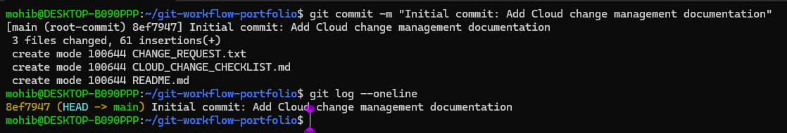
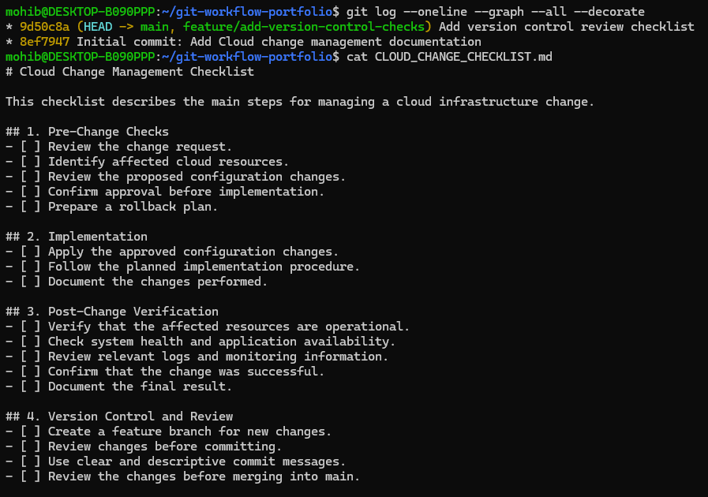
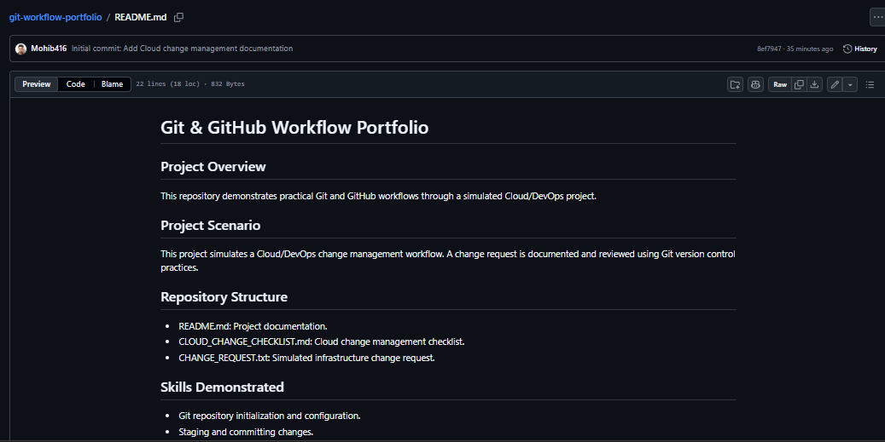

# Git & GitHub Workflow Portfolio

## Project Overview
This repository demonstrates practical Git and GitHub workflows through a simulated Cloud/DevOps project.

## Project Scenario
This project simulates a Cloud/DevOps change management workflow.
A change request is documented and reviewed using Git version control practices.

## Repository Structure
- README.md: Project documentation.
- CLOUD_CHANGE_CHECKLIST.md: Cloud change management checklist.
- CHANGE_REQUEST.txt: Simulated infrastructure change request.

## Skills Demonstrated
- Git repository initialization and configuration.
- Staging and committing changes.
- Reviewing changes and commit history.
- Branch creation and management.
- Merging branches and resolving conflicts.
- Connecting local repositories to GitHub.
- Pushing, pulling and cloning repositories.

## Project Screenshots

### 1. Repository Initialization and First Commit

### 2. Branching and Merge Workflow

### 3. GitHub Repository and Commit History

